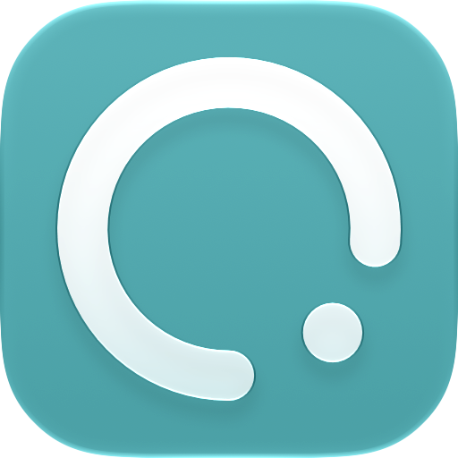
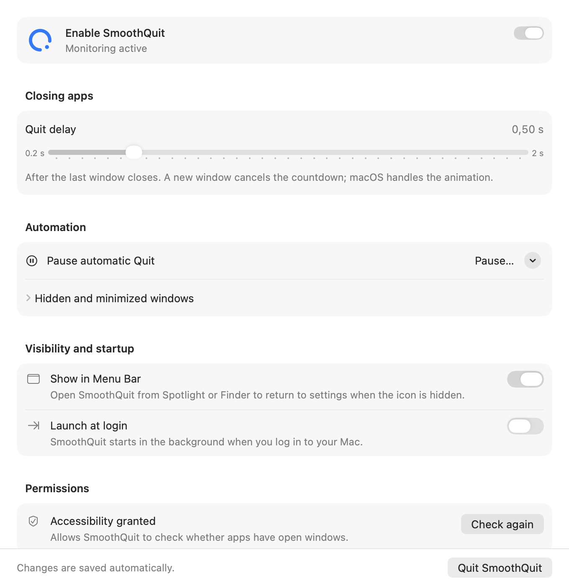

<p align="center"></p>
<h1 align="center">SmoothQuit</h1>
<p align="center">Close the last window. Let the app leave quietly.</p>
<p align="center"><a href="https://github.com/fkrzeminski-code/SmoothQuit/releases">Download</a> · <a href="docs/README.pl.md">Polski</a> · <a href="docs/SAFETY.md">How it works</a> · <a href="docs/TESTING.md">Testing</a></p>

SmoothQuit is a small, native macOS menu bar utility that asks an app to quit after its last normal window closes. The window closes normally, with the app's own macOS animation. SmoothQuit waits for your chosen delay, checks again, and sends a standard Quit request.

**Local signing.** Release builds are signed **ad hoc**, not Apple-notarized. macOS may block a downloaded build; a seamless install on another Mac is not guaranteed. You can inspect the source and build it yourself. No Apple Developer subscription is required to build locally.

## Download and install

1. Download `SmoothQuit.dmg` from [Releases](https://github.com/fkrzeminski-code/SmoothQuit/releases). Choose the latest release; the universal app contains Apple Silicon and Intel code.
2. Open the DMG and drag **SmoothQuit** into **Applications**. Quit an older running copy before replacing it. Run from Applications, not the mounted DMG, if you want launch at login.
3. In **System Settings → Privacy & Security → Accessibility**, add and enable SmoothQuit. This is its only required permission for window monitoring. Update alerts use optional notification permission, requested only when a newer release is found. If macOS blocks a trusted download, use its normal **Open Anyway** flow if offered; do not disable Gatekeeper or SIP.
4. In **Applications**, start with **Include** and add one app with an empty or disposable document. A fresh installation starts with an empty Include list, so it closes nothing until you select an app.
5. Turn on **Enable SmoothQuit**. The default delay is **0.5 seconds**.

The app supports **English and Polish** using native macOS localization. It follows your preferred language. To choose English just for SmoothQuit, open **System Settings → General → Language & Region → Applications**, add SmoothQuit and select English, then reopen it. The main README is maintained in English; [Polish installation instructions](docs/README.pl.md) are also available.

<picture>
  <source media="(prefers-color-scheme: dark)" srcset="docs/images/settings-dark.png">
  
</picture>

*Settings content rendered with test data on macOS 27; the live app also has a native three-pane preferences toolbar.*

## Features

- **Native window closing:** no intercepted clicks or keyboard shortcuts, no replacement close animation.
- **Adjustable delay:** 0.2–2 seconds, including overrides for individual apps.
- **Include / Exclude:** work only with selected apps, or exempt apps from automatic Quit. Per-app Always / Never rules take precedence.
- **Conservative checks:** existing normal, minimized, hidden, fullscreen, auxiliary and remembered off-Space windows prevent Quit. Ambiguous AX reads also prevent it.
- **Cancellation:** a new target-app window, disabling SmoothQuit, pausing or changing rules cancels pending work.
- **Menu bar optional:** hiding the icon leaves the service running. Open SmoothQuit from Finder or Spotlight to return to settings.
- **Clear menu bar states:** the orbit distinguishes active, disabled, paused, missing Accessibility and initial app selection. One centered 360° turn marks an intentional Enable/Disable action; automatic status refreshes stay still. Reduce Motion disables the turn.
- **Live pause countdown:** the open menu shows how much time remains, and Settings shows the remaining time too. Pause resumes automatically; Disable stays off until you enable it. The menu timer runs only while a paused menu is open.
- **Separate Enable and Quit:** disabling automation keeps SmoothQuit running. Closing settings hides the settings UI and lets macOS restore the foreground app and its menu. **Quit SmoothQuit** exits the utility itself.
- **Pause and launch at login:** native macOS controls, with no background helper to install.
- **Readable activity:** app names, icons, Quit requests, confirmed exits and cancelled or blocked decisions. A matched request and process exit form one activity row, with both available in Quit Details. Raw diagnostics stay available separately, with app filtering and Copy Details. Incoming entries wait behind a button so they do not move the list while you read.
- **Native rule editing:** searchable rules, a per-app settings sheet, custom delays and Undo/Redo for removal. The app chooser hides declared background helpers by default and supports manual Bundle IDs.

Finder is protected by default. SmoothQuit always protects its own process. A normal Quit lets the target app present its save dialog or refuse to quit; SmoothQuit never force-quits or repeatedly sends Quit.

- **Version and About:** the Settings footer displays the running app version. About shows the build number, project links and update controls. SmoothQuit’s app menu belongs to its active Settings UI; it does not take over another app’s menu in the background.
- **Updates:** Check for Updates manually, or check once at launch. Only a newer stable release triggers a local macOS notification, subject to your notification settings and Focus. Click it to view the release; downloads and installation remain your choice. No background polling or automatic installation.
- **Explain a running app:** Activity provides an explicit, read-only window/rule inspection without restarting monitoring or sending Quit.
- **Native settings menu:** opening Settings enables the standard SmoothQuit app menu (About, updates, settings and Quit) and a Dock icon. Closing Settings returns to background-only operation. Switching to another app gives that app its usual menu. Click the Advanced label or the space beside it to expand its options.
- **Broader native window discovery:** combines AXWindows with AXMainWindow and AXFocusedWindow, including apps whose AXWindows list omits their main window. A new-window notification is observed directly, before the list catches up.
- **Quick exceptions and reports:** Choose “Never Auto-Quit [app]” in the status menu to add a persistent Never quit rule for the last regular foreground app, without changing Include/Exclude mode. Copy Diagnostic Report copies version, macOS, rules and up to 20 filtered events to the clipboard; it never sends them.

Release 1.6.2 is published as a regular GitHub release. This does not change its ad hoc signing or imply Apple notarization.

## Privacy

No telemetry, analytics, ads, account or automatic installer. Version 1.6 adds a single anonymous HTTPS request to the public GitHub Releases API at launch, enabled by default, and on manual Check for Updates. Turn off **Check for updates at launch** to disable automatic requests. No application rules, window data or diagnostic reports are uploaded; GitHub receives ordinary connection metadata for the request. No window titles, document paths or contents, screenshots, or keystrokes are recorded. Diagnostics contain bundle identifiers, timing and decision reasons; the last 200 entries live only in memory. Preferences are saved locally using UserDefaults. Neither Screen Recording nor Input Monitoring is required. Notifications are optional and local; SmoothQuit does not register for remote push notifications.

Accessibility is a powerful system permission. SmoothQuit uses public AX APIs to observe window state, and `NSRunningApplication.terminate()` to request normal termination. [Read the safety model and limitations](docs/SAFETY.md).

## Compatibility and limitations

- Minimum deployment target: **macOS 14**. The current build is compiled with **Xcode 27.1 / macOS 27 SDK** and visually checked on macOS 27. Older systems and physical Intel hardware have not received the same live test coverage.
- Some apps don't expose reliable Accessibility windows or destruction events. SmoothQuit intentionally leaves them running when it cannot establish a safe result.
- Public APIs cannot provide a complete, atomic snapshot of every Space followed by an atomic Quit. The identity ledger and final checks reduce that risk; they cannot make such a guarantee.
- After replacing an ad-hoc-signed build, you may need to remove its old Accessibility entry and add the new app. Keep one installed copy to avoid confusion with permissions and launch at login.
- The configured delay starts when SmoothQuit receives the destruction event. IPC and scheduling add some time; diagnostics distinguish the Quit request from the eventual process exit.

## Build from source

Use full Xcode 27.1 or newer with its command-line tools selected (including Icon Composer support). The release script was verified with Xcode 27.1; it downloads no dependencies.

```sh
git clone https://github.com/fkrzeminski-code/SmoothQuit.git
cd SmoothQuit
swift test
./scripts/build.sh
```

Output: `Builds/Release-1.6.2/SmoothQuit.app` and `SmoothQuit.dmg`, with build/test/signature reports and a source snapshot. The script does not install or launch the app. Build products are ignored by Git.

Open `Package.swift` in Xcode to work on the project. SwiftUI and AppKit provide the interface; AXObserver, NSWorkspace and CoreGraphics provide observation. There are no third-party runtime packages.

## Testing and contributing

[Testing notes](docs/TESTING.md) distinguish automated checks, real app tests, and untested scenarios. Interactive tests are opt-in and must only be run against authorized, disposable windows. Ordinary `swift test` never launches or quits a target app.

For bugs, include your macOS version, SmoothQuit version, target app and bundle ID, Include/Exclude rules, configured delay and a short reproduction. Share only the relevant diagnostic lines; omit personal document or message contents. Keep contributions small, native and conservative about closing applications.

## Credits and license

[SmartClose](https://github.com/mahirozdin/SmartClose), [Quitty](https://github.com/chentao1006/Quitty) and [last-window-quits](https://github.com/mikecann/last-window-quits) informed the comparison of approaches. [Vorssaint](https://github.com/vorssaint/vorssaint-utils) inspired visual consistency between an app and its menu bar icon. No source code or brand assets from those projects are included. SmoothQuit's orbit is original vector artwork.

[MIT License](LICENSE). SmoothQuit is an independent project and is not affiliated with Apple or the projects above.
